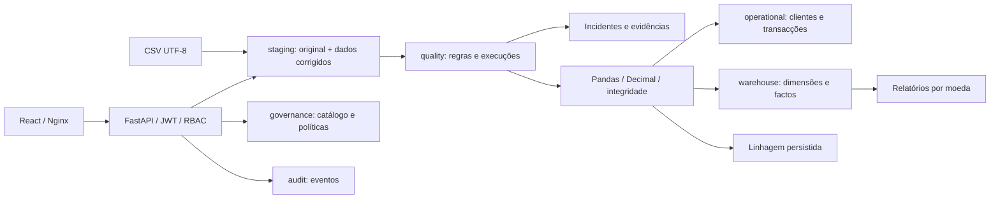

# Arquitectura

Monólito modular: a API concentra regras de negócio e permissões; o cliente React apresenta dados obtidos via Axios/TanStack Query. Todas as gravações usam transacções SQLAlchemy. PostgreSQL possui seis schemas; SQLite com `schema_translate_map` é uma alternativa de teste.

Decisões: importações com erros são preservadas sem violar o operacional; chaves únicas bloqueiam duplicação; bloqueio do lote serializa correcções/validações/cargas no PostgreSQL; carga é atómica. O pipeline revalida antes de carregar e valida contratos Pydantic como defesa adicional. Falhas de integridade fazem rollback, com HTTP 409 sem detalhes SQL.

Autenticação: Argon2, JWT HS256 com expiração e versão por utilizador; logout, alteração de senha e de permissões revogam tokens anteriores. Token fica apenas na memória do frontend; actualizar a página exige novo login. Não existem tokens em URL ou localStorage. As dez falhas por utilizador em cinco minutos suspendem temporariamente novas tentativas. CORS limita origens locais configuradas.

Papéis: ADMIN gere tudo; DATA_OWNER gere políticas e classificações; DATA_STEWARD regras, correcções e incidentes; DATA_ENGINEER importações e ETL; AUDITOR auditoria e leitura mascarada. Leitura operacional é permitida aos cinco papéis, mas owner/auditor recebem identificação pessoal mascarada. Staging com dados brutos é reservado aos perfis técnicos. Não há endpoints de alteração/remoção de auditoria.

Sem microserviços: execução síncrona, sem Kafka, Kubernetes ou dependências pagas. Para produção seriam necessárias gestão de segredos dedicada, observabilidade, recuperação, TLS e segregação de administração; não são pressupostos desta demonstração local.

Fonte académica: texto de requisitos anexado. Slides ausentes; não foi feita análise de um ficheiro inexistente. As metas e papéis vêm exclusivamente desse texto.
