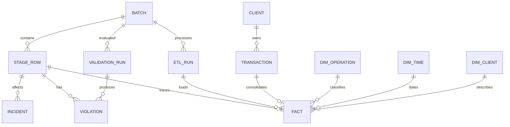

# Modelo de dados

| Schema | Tabelas e responsabilidade |
|---|---|
| operational | clients, transactions: registos válidos; documentos e identificadores únicos |
| staging | batches, rows: checksum por dataset, número da linha, original, correcção actual e marca de carga |
| quality | rules, validation_runs, violations, incidents: snapshots, métricas, evidências e histórico |
| warehouse | etl_runs, dim_cliente, dim_tempo, dim_tipo_operacao, fact_transaccao |
| governance | users, datasets, policies, lineage_nodes, lineage_edges |
| audit | events: utilizador, acção, entidade, referência, instante, resultado e metadados |

Relações via foreign keys, incluindo referências entre schemas. Quantias são NUMERIC(18,2), convertidas a strings JSON. Operacional impõe montante positivo, identificador de transacção único, par fonte/referência externa único, cliente existente e documento único.

Grão da fact_transaccao: **uma linha por transacção válida, elegível e com estado COMPLETED**. Chaves transaction_id e row_id únicas. Moeda sempre preservada; não se somam moedas diferentes. `quantity=1`; `amount` é Decimal positivo, sem atribuir sinal contabilístico. Os relatórios apresentam volume bruto, não saldo.

dim_cliente é tipo 1 (actualização do nome/localização), dim_tempo possui data única, dia, mês, ano e trimestre, dim_tipo_operacao possui código único. Não existe SCD tipo 2 neste cenário.

etl_runs possui unicidade (batch_id, revision). Reexecutar uma revisão devolve a carga existente. Corrigir staging aumenta a revisão; uma tentativa explícita por `/etl/retry` também incrementa a revisão para reavaliar dependências externas. Linhas já carregadas são imutáveis, e a nova carga considera apenas linhas ainda não carregadas. Originais de staging nunca são reescritos.

Migração inicial Alembic `0001` contém operações explícitas e congeladas para as 19 tabelas; não depende de importar os modelos actuais. Migrações subsequentes devem ser novas revisões explícitas. Não alterar uma revisão já aplicada em ambientes existentes.

Instantes das respostas são UTC e a interface apresenta Africa/Maputo. No PostgreSQL os campos SQLAlchemy DateTime iniciais não guardam offset; os valores são escritos em UTC. D+1 é calculado explicitamente em UTC+2. O prazo de relatório fica registado no ETL.
