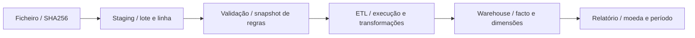

# Linhagem persistente

Na importação são criados SOURCE (nome e checksum do ficheiro) e STAGING (lote). Cada validação acrescenta VALIDATION com revisão, contagens e ligação ao staging. O ETL real acrescenta ETL, WAREHOUSE e REPORT e respectivas dependências. O frontend React Flow recebe `/api/lineage`; a visualização não inventa nós antes de o processamento existir.

Linhagem de registo: fact_transaccao mantém row_id, transaction_id e etl_id. O ETL referencia validation_id e batch_id. Staging preserva external_id, número da linha CSV e original. Assim `/api/lineage?transaction_id=1` pode devolver ficheiro, identificador original, lote, validação, transformações, facto e nó de relatório afectado.

Transformações: remoção de espaços na entrada; parsing ISO e Decimal; classificação por tipo; obtenção das chaves dimensionais; filtro COMPLETED; agregação nos endpoints de relatório por moeda. Pandas constrói o quadro de linhas elegíveis sem converter montantes em float.

`REPORT` representa uma vista lógica de relatório suportada pelo warehouse, não um PDF materializado. Os grafos por lote acumulam validações e revisões. Nó seleccionado mostra tipo, descrição, estado e instante. Por omissão consulta-se o último lote para evitar carregar todo o histórico. Transacções manuais ainda sem facto ETL não possuem esta rastreabilidade dimensional e devolvem 404 explicativo.
